# FENATRAN 2026 Benchmarking - User guide

This guide is for the people who evaluate trucks, components, services and other offers at the FENATRAN 2026 fair. It covers how to install and open the app, record evaluations, send them on WhatsApp to the person collecting the evaluations, and keep your phone storage under control. The same tips are in the app: tap the **?** icon at the top right.

The app works offline. You need an internet connection only to open it for the first time, and again when the team publishes an update.

## 1. Install and open the app

App link: <https://brenog-rossi.github.io/benchmark-FENATRAN/>

1. Open the app link on your phone or laptop, using the browser of your device (Safari on iPhone, Chrome on Android, Edge or Chrome on a laptop).
2. Wait until the first screen appears. The app downloads everything it needs during this first visit.
3. Optional: add the app to your home screen from the browser menu (on iPhone: Share, then "Add to Home Screen"; on Android: the menu, then "Install app" or "Add to Home screen"). It then opens like an app.

Do this once with internet access, before the fair. After that the app opens without a connection.

Your data is stored only on your device. Nothing is uploaded until you export it and share the ZIP files yourself.

### If the link is blocked on your computer

Some company networks block the app address. On the phone, use mobile data (4G/5G) for the first visit; after that the app works offline. On a computer, ask the team that maintains the app to run it locally for you; it then opens at <http://localhost:4173>. Data saved on the computer is separate from the data on your phone, so record fair evaluations on the phone.

## 2. Your profile

The first time you open the app, it asks only for your **e-mail**. Use your work e-mail: it identifies your evaluations in the export.

Below the e-mail, **Appearance** lets you choose the colours right away: **Auto** (the default) follows your phone's light or dark mode, **Light** and **Dark** keep that look. The choice applies at once, before you tap **Start**, and you can change it later in your profile.

Tap **Start**. When you start, the app asks the browser to keep your data safe on the device (persistent storage). Accept the browser prompt if it appears.

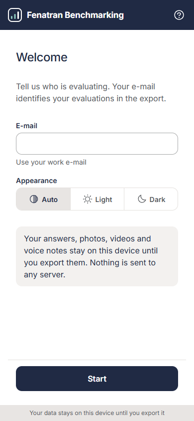

The two icons at the top right of every screen are:

- **?** (Help): opens over the screen you are on, with the screen blurred behind it. On a phone, **How it works**: six step cards of the same height, each with a small picture of the screen. Swipe left for the next step. On a computer, short tips for every task at the fair. Tap **X**, tap outside the card or use the phone's back to close it: you are back on the same screen, with nothing lost.

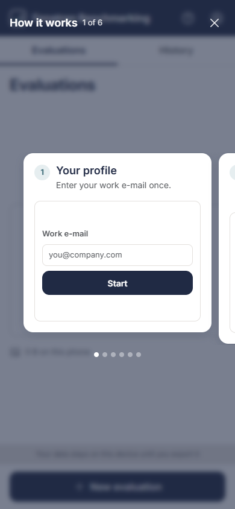
- **Profile** (person icon): the screen shows a person icon, your e-mail and the note that your data stays on the phone. Change your e-mail, then tap **Save profile**. Everything fits on one phone screen.

**Appearance** sets the colours: **Auto** (the default) follows your phone's light or dark mode, **Light** and **Dark** keep that look. The choice applies at once, without **Save profile**. It is a setting of this phone: it is not part of the export, and **Delete profile and data** does not reset it.

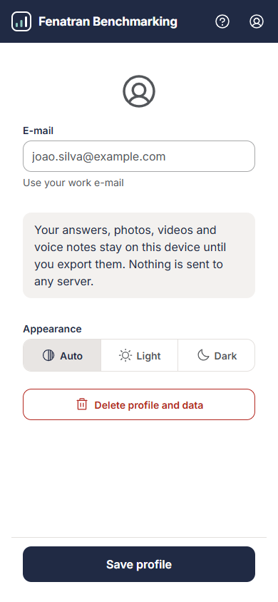

The red outlined **Delete profile and data** button removes your profile, all evaluations and all media from this phone, after you confirm with **Delete everything**, and the app returns to the first page. Export first if you need the data. This cannot be undone.

## 3. Home screen

The home screen lists your evaluations, grouped by day (newest day first, for example "Today · Thu 29 Oct"). Each row shows the truck or the other item, how many attributes are scored (trucks) or how many media items it has (other evaluations), and a status chip:

- **Draft**: you have not finalized it yet.
- **Ready**: finalized and ready to export. You can still edit it.

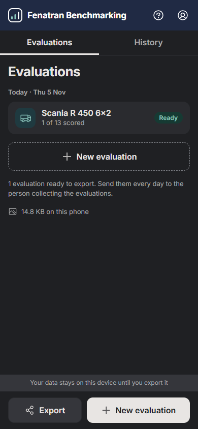

Below the list you also see:

- a hint with the number of evaluations ready to export;
- on a computer, the exports you already sent ("... · sent"), with **Share again** (section 8);
- how much photo, video and audio data is stored on this phone.

The bar at the bottom has **Export** (shown when you have evaluations) and **New evaluation**.

On a phone, the home screen has two tabs at the top: **Evaluations** (the list) and **History**. History shows one card for each of the last 60 exports you sent: the date and time, each evaluation sent (title, Truck with the number of scored attributes, or Other with its category) and a **Share again** button (section 8). Exports made before version 3.1 show "No list saved for this export", and exports made before version 3.5 have no **Share again**. The **New evaluation** button stays at the bottom on both tabs.

On a phone, the list ends with a dashed **+ New evaluation** card, which does the same as the button in the bar.

If you have no evaluations yet, a phone shows a large **New evaluation** card in the middle of the screen; tap it or the button at the bottom. On a computer, the list says "No evaluations yet. Start with New evaluation."

### Delete an evaluation from the list

Swipe a row to the left. A **Delete** button appears behind it: tap it, or swipe further to delete at once. The message "Evaluation deleted" shows an **Undo** button for 5 seconds; tap it to bring the evaluation and its media back.

## 4. Create an evaluation

1. Tap **New evaluation**.
2. Tap **Truck** or **Other**. Use Other for anything that is not a truck: a component, service, aftermarket offer, partner or anything else.

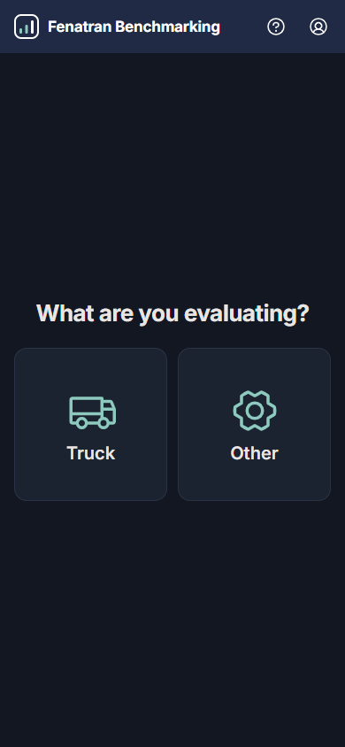

### Truck evaluation

The truck editor has two parts. The top line has a back arrow (to the home screen), the name of the truck ("Untitled truck" until you choose the brand or type the model; a long name ends with "…"), the **Draft** or **Ready** chip, **?** (how to score) and the menu. On a phone the whole editor fits one screen.

Required fields have a red **\*** after their name, and "\* Required" is written once under the top line. If you leave a required field empty, its message appears below it ("Enter the model"); it goes away as soon as you fill it in.

**Vehicle**

- **Brand** and **Model** (both required), side by side. Brand: choose from the list; choose "Other" and fill in **Brand name** (required), which appears below. Model: for example "R 450 6x2".
- **Brochure photos**: the camera and gallery buttons below Brand add photos of the brochure. Only photos are allowed here. The camera button shows how many photos there are; **See N media** opens them.
- **First impressions** (optional): the button next to the gallery button opens a text box below the line for what strikes you first about the truck. The grey example text disappears when you type. The box grows as you write, then scrolls. Tap the button again to close it.

**Truck Attributes Checklist**

There are 13 attributes in three sections: "Chassis & build", "Cab access & interior" and "Living space". The line above the checklist shows the total ("1 of 13") and a bar.

On a phone, nothing is open at first. The checklist is four tiles: one per section, each with how many of its attributes are scored ("1 of 4 scored"), and **Add attribute** (a low row across the screen when it is alone on the last line). Tap a tile to open its attributes as cards over the screen. Swipe left or right to move between them; each card stops in the middle of the screen, all cards have the same size, and the dots under the cards show where you are. Tap **×** (top right), tap outside the cards or press Escape to go back.

Each card shows the number and the short title (for example "Seats"), with a **?** at the end of the title line. Tap **?** to read the full description of the attribute in a small pop-up; tap **?** again, tap anywhere else, press Escape or swipe to another card to close it. Attributes you add have no description, so they have no **?**. Below the title:

- **Score**: 0 to 5, in one bar. Tap a number to select it: the numbers up to it take a colour (red for 0-1, amber for 2-3, green for 4-5) and the chosen one is solid. Tap the selected number again to remove the score.
- **Media buttons**: a centred row of buttons for the photos, videos and voice notes of this attribute (section 5). The card shows no thumbnails: the buttons show how many items there are, and **See N media** opens them.
- **Comment**: your observation in writing ("Add a comment"). The box grows as you type; long comments scroll inside the box.

On a computer, the sections are a list. Tap a section title to open or close it, then tap an attribute to open it. The score there has a **Clear** button.

You do not have to score every listed attribute. An unscored attribute shows "-" in the summary and is blank in the Excel file.

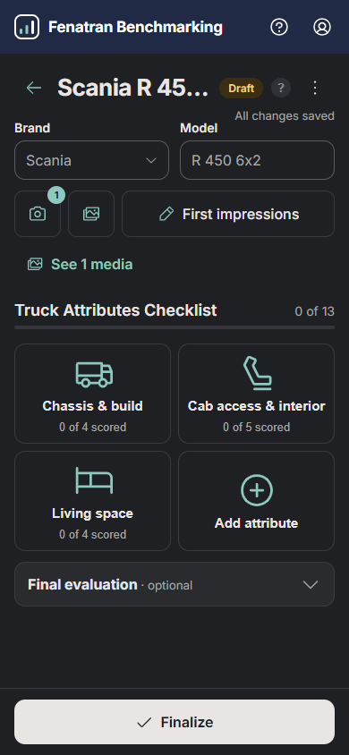

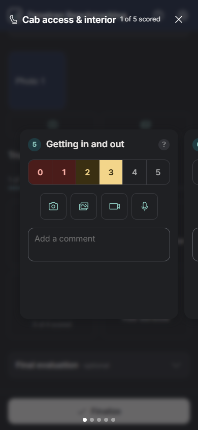

**Final evaluation**

Below the checklist, tap **Final evaluation** (optional) to write your overall view of the truck. Like First impressions, it opens by itself when it already has text; tap the row again to close it. On a phone it sits just above **Finalize**.

**Your attributes**

If you find something the list does not cover, tap **+ Add attribute**, type a name (up to 60 characters, different from the other attributes) and tap **Add**. The new card opens with the same score, comment and media fields; on a phone, it opens in a "Your attributes" tile. Attributes you add **need a score**: they show "Required" until you score them, and **Finalize** takes you to the first one without a score. To delete one, open it and tap **Remove attribute**; its score, comment and media are deleted.

### Other evaluation

- **Category**: tap one of **Component**, **Service**, **Aftermarket**, **Partners** or **Other**. A new evaluation starts as Component.
- **Name** (required): for example "Battery", "Fleet portal" or "Service plan".
- **Manufacturer** (required): the supplier, brand or company.
- **Images, videos and voice notes**: the media for this evaluation.
- **Comments and observations**: free text.

To finalize, only these are required: brand and model (truck), the scores of the attributes you added (truck), or the name and the manufacturer (Other). **Finalize** shows "Fill in the required fields first." and the message under each empty required field.

### Autosave

Your changes are saved automatically on the device; you do not need to press a save button. A small note under the top line of the editor shows:

- "Saving..." while the app writes the change.
- "All changes saved" when it is done.

If the phone is out of storage, "Could not save. Check free storage." appears in red on its own line. Free some space (section 9) and try again.

### Delete from the editor

Open the menu at the top right of the editor (three dots, "More actions") and choose **Delete evaluation**. The app asks "Delete this evaluation?" before it removes the evaluation and its media.

## 5. Media

Each media area is a row of icon buttons, with no title: **Camera** (take a photo now), **Gallery** (choose photos or videos already on the phone), **Video** (record a video) and **Voice note** (record a voice note; on devices without recording support, the app lets you pick an audio file instead).

Brochure photos accept photos only.

On a phone, the attribute cards of a section panel do not show thumbnails, so the score always stays visible. Instead, a small number on **Camera**, **Video** and **Voice note** shows how many photos, videos and voice notes the attribute has (photos from the gallery count on Camera, videos from the gallery on Video). Below the buttons, **See N media** opens a sheet with all the items of that attribute; tap one to open it, as described below. When you close the item, the sheet comes back; tap **Close** or outside it to return to the card.

Right after you take a photo or choose one from the gallery, a card opens in the middle of the screen with the photo and a caption box. Type what the photo shows and tap **Save**, or tap **Skip** to add it later. Videos and voice notes do not open this card.

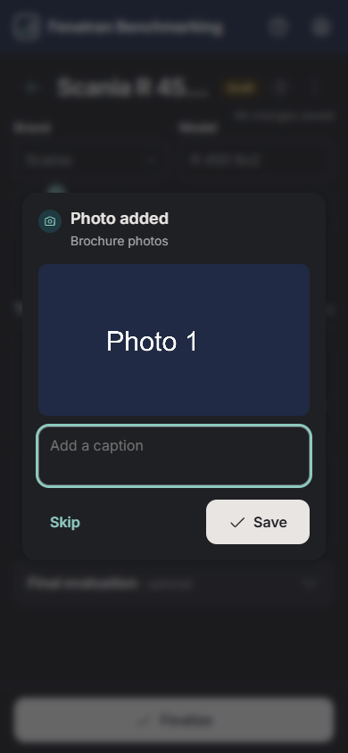

Tap an item to open it. In the item sheet you can:

- **Observation**: a short description of what the item shows (up to 500 characters). This text is used as the caption in the export and in the photo gallery. Only photos and videos with an observation appear in the gallery.
- **Mark up**: draw on a photo with a pen (4 colours, Undo), then tap **Save copy**. The copy has your marks; the original photo is kept.
- **Remove**: delete the item.
- **Done**: close the sheet.

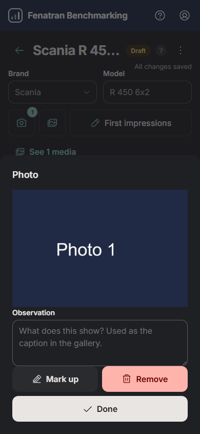

Photos larger than 4096 px are resized when they are stored. Videos and voice notes are stored as recorded. The export keeps photos in this quality.

## 6. Finalize

When an evaluation is complete:

1. Open it and tap **Finalize** at the bottom.
2. The **Review** screen shows a summary card (title, number of attributes scored, photos) and one row per section of the checklist, plus **Your attributes** if you added any. Each row shows how many attributes are scored and their average, for example "4 of 4 · avg 3.0". The first section is open; tap another to see all its attributes and scores (0-1 red, 2-3 yellow, 4-5 green; "–" means not scored). If something required is missing, the screen lists it under "Required before finalizing".
3. Tap **Confirm and finalize**. To keep working, tap the back arrow at the top.

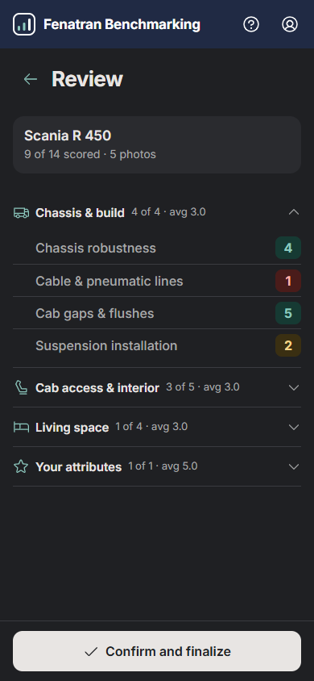

The "Evaluation saved" screen confirms it. The evaluation stays on this phone until you export it. After 2 seconds the app goes back to the Home list by itself (a short bar shows the count). Tap anywhere to stay on the screen; tap **New evaluation** to continue, or **Home** to go back to the list.

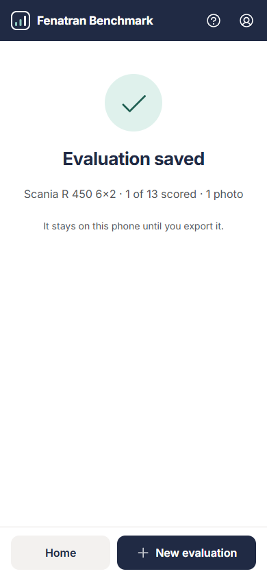

Finalized evaluations can still be changed. In that case the button in the editor reads **Review summary**.

## 7. Export to WhatsApp

Export once a day. Each export holds only the evaluations that are new or edited since your last export; nothing is deleted from the phone.

1. From the home screen tap **Export**.
2. "Today's export" says "New and edited evaluations since your last export." When some evaluations were already sent, a line such as "2 new · 3 already sent" shows how many go in this time. The screen shows how many trucks, other evaluations and photos go into the ZIP, the videos, voice notes and media size, and the list of evaluations. Drafts are included as they are; a note names them.
3. Tap **Create and share ZIP**. Photos are exported in original quality.

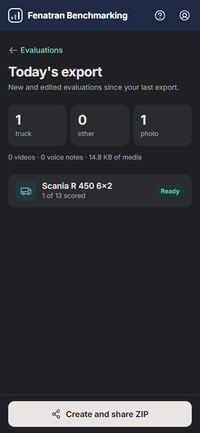

The file name looks like `FENATRAN2026_<e-mail name>_<yyyy-mm-dd>.zip`, where the e-mail name is the part of your e-mail before the @.

### If the export is too big

On **Chrome and Edge** (computer and Android), the app splits a big export by itself into parts of up to 50 MB (`..._part1of3.zip`, ...), because these browsers cannot share a bigger file. It does not ask. A part with one video bigger than 50 MB can only be downloaded (see below).

On **iPhone** (Safari), WhatsApp accepts files up to 100 MB. If the export is bigger, the app shows "The export is too big for WhatsApp" with three choices:

- **Split into parts**: creates several ZIP files (`..._part1of2.zip`, `..._part2of2.zip`). Each part has the full `data.json`, so any part can be read on its own.
- **Export without videos**: only available if there are videos. Photos and voice notes are kept.
- **Go back**: delete media first.

### Share the files

The screen "Your ZIP is ready" lists each ZIP file:

1. Tap **Share** to send the ZIP on WhatsApp to the person collecting the evaluations. If sharing is not available, tap **Download** and attach the file in WhatsApp as a **document** (not as photo or gallery), so nothing is compressed.
   - On a computer or an Android phone (Chrome, Edge), the shared file arrives in WhatsApp as `FENATRAN2026_….zip.txt`. This is normal: it is the same ZIP. Do not rename it.
   - A part bigger than 50 MB shows "Too big to share from this browser. Download it and attach it in WhatsApp." and only the **Download** button.
   - If Share shows "Sharing did not work. Use Download instead.", tap **Download** yourself; the app never downloads on its own.
2. Each ZIP you share or download gets a check mark. When every ZIP has one, the title changes to "Day sent" and the evaluations in it count as sent (section 8).
3. **Return home** goes back to the home screen and deletes nothing.

The ZIP holds the evaluations of this export: the data, the summary, the Excel file, and their photos, videos and voice notes with their observations.

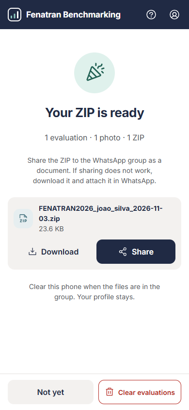

## 8. After sending: everything stays on the phone

The export never deletes anything. Once every ZIP has a check mark (shared or downloaded), the evaluations in it count as sent:

- They stay in the list on the home screen, and you can still open and change them.
- The next export leaves them out. If you change a sent evaluation (text, score, photo, observation, or a removed item), it goes in the next export again, with all its data.
- If you create the ZIP and leave without sharing or downloading every part, nothing counts as sent, and the same evaluations go in the next export.
- When nothing is new or changed, **Export** shows "Nothing new to send" and no ZIP is created.

The home screen keeps a record of each export sent: on a phone in the **History** tab, on a computer as a short line for each export.

### Share an export again

If a ZIP did not arrive, or someone asks for it again, open **History** and tap **Share again** on that export. The app creates the same ZIP again: the same file name, the same parts, and the evaluations, photos, videos and voice notes exactly as they were when you sent it, even if you changed or deleted them afterwards. Share or download each ZIP as before; the title becomes "Sent again". Nothing is marked or logged again.

A photo, video or voice note that you delete after sending stays hidden on the phone while an export in History uses it, so it still takes space (it counts in the storage line). It is deleted for good when that export leaves History (History keeps the last 60 exports) or with **Delete profile and data**.

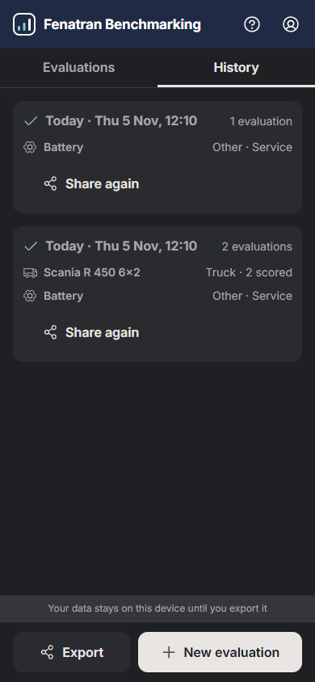

To delete everything from the phone, use **Delete profile and data** on the profile screen (section 2). That is the only way to delete the evaluations all at once, and it cannot be undone.

## 9. Storage tips

- Check the storage line at the bottom of the home screen often.
- On iPhone, add the app to your home screen (section 1, step 3). Safari can clear the data of a website that was not opened for 7 days; an app on the home screen is safer, and you should export every day anyway.
- Export daily. The evaluations stay on the phone after the export, so the stored media grows each day (a typical day with 80 photos and 5 videos takes about 365 MB). Delete single evaluations you no longer need, or use **Delete profile and data** at the end of the fair.
- Photos are exported in original quality. Export every day: each export holds only what is new or changed, so the ZIP stays small.
- Use **Remove** on duplicate or blurry photos before you export.
- Keep free storage on the device. Close other apps before a long export.
- If you see "Could not save. Check free storage.", stop recording, free space, and try again.

## 10. Troubleshooting

| Problem | What to do |
| --- | --- |
| The app shows "Could not read data on this device". | Tap **Try again**. If it keeps happening, restart the browser. Your data is not removed. |
| You deleted an evaluation by mistake. | Tap **Undo** in the message at the bottom within 5 seconds. After that it cannot be restored. |
| The app is out of date. | Connect to the internet and reopen the app. The new version is used on the next visit. |
| Camera or microphone does not work. | Allow the camera and microphone for the browser in the phone's settings. |
| The ZIP does not share. | Tap **Download** and send the file from your downloads. |
| A file received on WhatsApp ends in `.zip.txt`. | It was shared from Chrome or Edge. It is the same ZIP; do not rename it. |
| The app link does not open on a computer. | The network may block it. Use the local run at <http://localhost:4173> (see section 1). |

For questions about the app, contact the development team.
