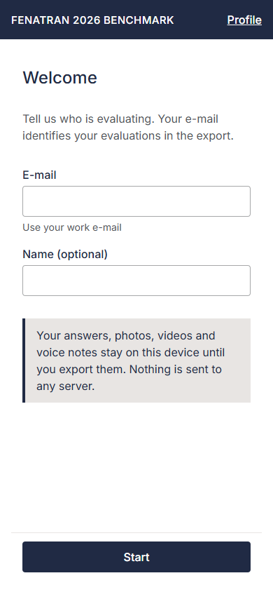
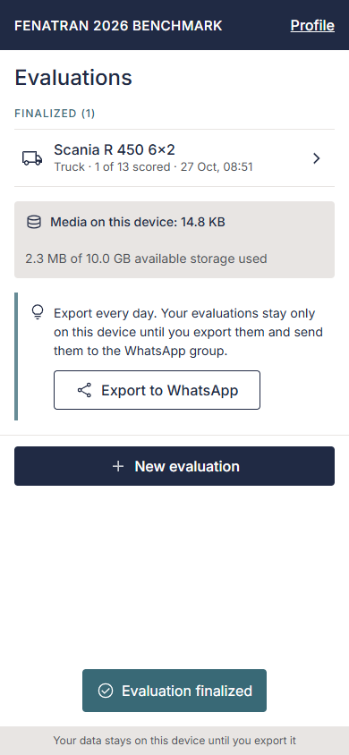
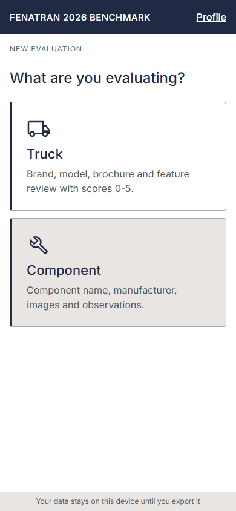
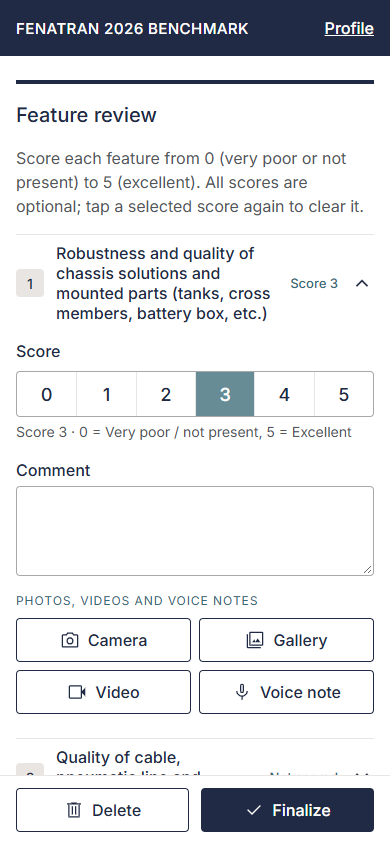
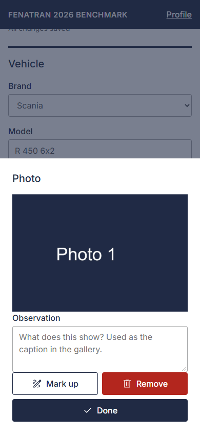
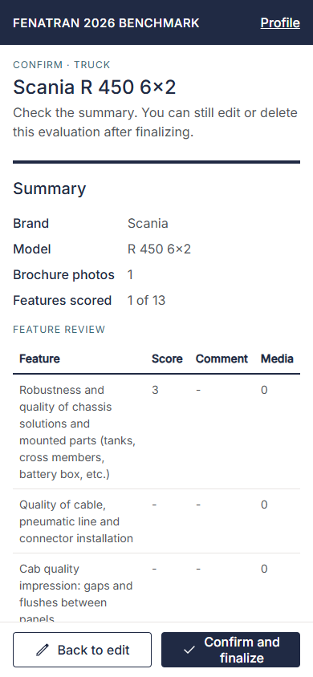
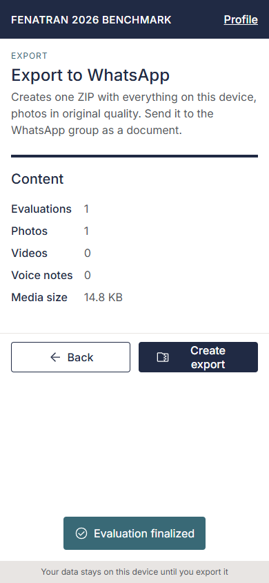
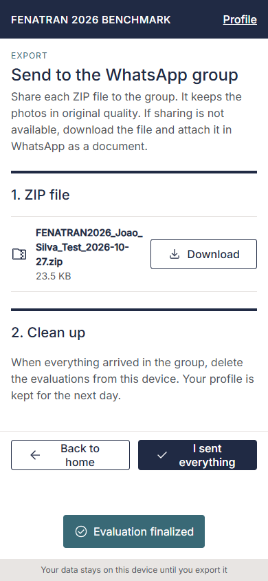

# FENATRAN 2026 Benchmark - User guide

This guide is for the people who evaluate trucks and components at the FENATRAN 2026 fair. It covers how to install and open the app, record evaluations, export them to the team's WhatsApp group, and keep your phone storage under control.

The app works offline. You need an internet connection only to open it for the first time, and again when the team publishes an update.

## 1. Install and open the app

App link: <https://brenog-rossi.github.io/benchmark-FENATRAN/>

1. Open the app link on your phone or laptop, using the browser of your device (Safari on iPhone, Chrome on Android, Edge or Chrome on a laptop).
2. Wait until the first screen appears. The app downloads everything it needs during this first visit.
3. Optional: add the app to your home screen from the browser menu (on iPhone: Share, then "Add to Home Screen"; on Android: the menu, then "Install app" or "Add to Home screen"). It then opens like an app.

Do this once with internet access, before the fair. After that the app opens without a connection.

Your data is stored only on your device. Nothing is uploaded until you export it and share the ZIP files yourself.

### If the link is blocked on your computer

Some company networks block the app address. On the phone, use mobile data (4G/5G) for the first visit; after that the app works offline. On a computer, ask the team that maintains the app to run it locally for you; it then opens at <http://localhost:4173>. Data saved on the computer is separate from the data on your phone, so record fair evaluations on the phone.

## 2. Your profile

The first time you open the app, it shows one page:

- **E-mail** (required): use your work e-mail. It identifies your evaluations in the export.
- **Name (optional)**: your name as you want it shown.

Tap **Start**. You can change your profile later from the Profile link in the header (button "Save profile").

When you start, the app asks the browser to keep your data safe on the device (persistent storage). Accept the browser prompt if it appears.

## 3. Home screen

After that you see "Welcome, <your first name>" (or "Welcome" without a name), the **New evaluation** button, and your list of evaluations:

- **Drafts** are evaluations you have not finalized yet.
- **Finalized** are evaluations you have finalized. You can still edit them.

The home screen also shows:

- **Media on this device**: how much photo, video and audio data is stored.
- A tip to export every day, with the **Export to WhatsApp** button (shown when you have evaluations).

If you have no evaluations yet, the screen says "No evaluations yet. Start with New evaluation."

## 4. Create an evaluation

1. Tap **New evaluation**.
2. Choose **Truck** or **Component**.

### Truck evaluation

The truck editor has two parts.

**Vehicle**

- **Brand**: choose from the list. Choose "Other" and fill in **Brand name**.
- **Model**: for example "R 450 6x2".
- **Brochure photos**: add photos of the brochure. Only photos are allowed here.

**Feature review**

There are 13 feature cards. Open a card to fill it in:

- **Score**: 0 to 5. Tap a number to select it. Tap the selected number again to clear it ("Not scored"). 0 means "Very poor / not present" and 5 means "Excellent".
- **Comment**: your observation in writing.
- **Photos, videos and voice notes**: the media for this feature.

You do not have to score every feature. An unscored feature shows "-" in the summary and is blank in the Excel file.

### Component evaluation

- **Component**: for example "Battery", "Headlamp" or "Seat".
- **Manufacturer**.
- **Images, videos and voice notes**: the media for the component.
- **Comments and observations**: free text.

Only the brand and model (truck) or the component name are required to finalize.

### Autosave

Your changes are saved automatically on the device. The status line shows:

- "Saving..." while the app writes the change.
- "All changes saved" when it is done.
- "Could not save. Check free storage." if the phone is out of storage. Free some space (see section 9) and try again.

You do not need to press a save button.

## 5. Media

Each media area has the same buttons:

- **Camera**: take a photo now.
- **Gallery**: choose photos or videos already on the phone.
- **Video**: record a video.
- **Voice note**: record a voice note. On devices without recording support, the app lets you pick an audio file instead.

Brochure photos accept photos only.

Tap an item to open it. In the item sheet you can:

- **Observation**: a short description of what the item shows (up to 500 characters). This text is used as the caption in the export and in the photo gallery. Only photos and videos with an observation appear in the gallery.
- **Mark up**: draw on a photo with a pen (4 colours, Undo). Saving creates a copy with your marks. The original photo is kept.
- **Remove**: delete the item.
- **Done**: close the sheet.

Photos larger than 4096 px are resized when they are stored. Videos and voice notes are stored as recorded. The export keeps photos in this quality.

## 6. Finalize

When an evaluation is complete:

1. Open it and tap **Finalize**.
2. Check the summary. It lists the evaluation facts, the scored features, and what will be exported (photos, videos and voice notes).
3. Tap **Confirm and finalize** to mark it as finalized, or **Back to edit** to keep working.

To finalize and export in one step, tap **Finalize and export** on the same screen. This opens the export screen.

Finalized evaluations can still be changed. In that case the button reads **Review summary**.

To delete an evaluation, open it and tap **Delete**. The app asks "Delete this evaluation?" before it removes the evaluation and its media.

## 7. Export to WhatsApp

Export once a day, and always before you wipe the phone.

1. From the home screen tap **Export to WhatsApp**, or use **Finalize and export** from an evaluation.
2. On the export screen, check the **Content** counts. Drafts are included with a note.
3. Tap **Create export**. Photos are exported in original quality.

The app creates one ZIP file per part. The file name looks like `FENATRAN2026_<Your_Name>_<yyyy-mm-dd>.zip`.

### If the export is too big

WhatsApp accepts files up to 100 MB. If the export is bigger, the app shows "The export is too big for WhatsApp" with three choices:

- **Split into parts**: creates several ZIP files (`..._part1of2.zip`, `..._part2of2.zip`). Each part has the full `data.json`, so any part can be read on its own.
- **Export without videos**: only available if there are videos. Photos and voice notes are kept.
- **Go back**: remove media first.

### Share the files

The share screen has two steps:

1. **ZIP file(s)**: tap **Share** to send each ZIP to the WhatsApp group. If sharing is not available, tap **Download** and attach the file in WhatsApp as a **document** (not as photo or gallery), so nothing is compressed.
2. **Clean up**: when everything is sent, use **I sent everything** to delete the data from the phone (section 8).

The ZIP holds everything: the data, the summary, the Excel file, and all photos, videos and voice notes with their observations.

## 8. Wipe after sending

After you have sent everything to the group, delete the data from the phone:

1. On the share screen, tap **I sent everything**.
2. The dialog "Delete evaluations from this device?" asks you to confirm. Tap **Delete evaluations**.

This deletes all evaluations and all media. Your profile is kept, so you do not have to fill it in again.

Do not wipe until all ZIP files have reached the group. The deletion cannot be undone.

## 9. Storage tips

- Check the **Media on this device** figure on the home screen often.
- Export daily. Each export frees room for new evaluations once you wipe after sending.
- Photos are exported in original quality, so ZIP files grow quickly. Export every day to keep each ZIP small.
- Use **Remove** on duplicate or blurry photos before you export.
- Keep free storage on the device. Close other apps before a long export.
- If you see "Could not save. Check free storage.", stop recording, free space, and try again.

## 10. Troubleshooting

| Problem | What to do |
| --- | --- |
| The app shows "Could not read data on this device". | Tap **Try again**. If it keeps happening, restart the browser. Your data is not removed. |
| The app is out of date. | Connect to the internet and reopen the app. The new version is used on the next visit. |
| Camera or microphone does not work. | Allow the camera and microphone for the browser in the phone's settings. |
| The ZIP does not share. | Tap **Download** and send the file from your downloads. |
| The app link does not open on a computer. | The network may block it. Use the local run at <http://localhost:4173> (see section 1). |

For questions about the app, contact the development team.
