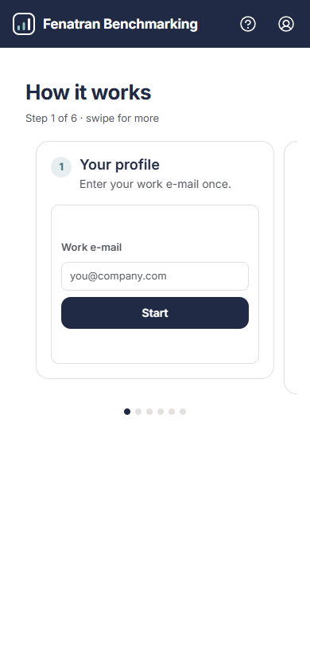
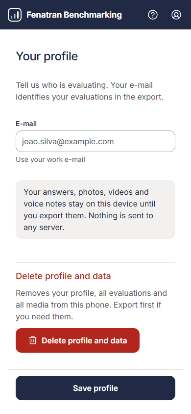
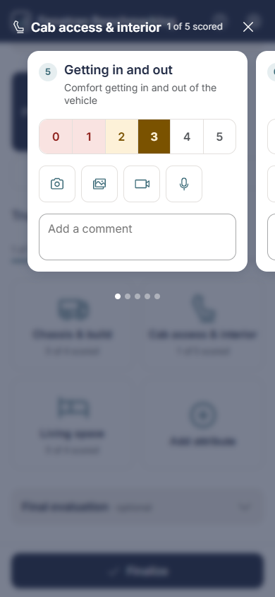
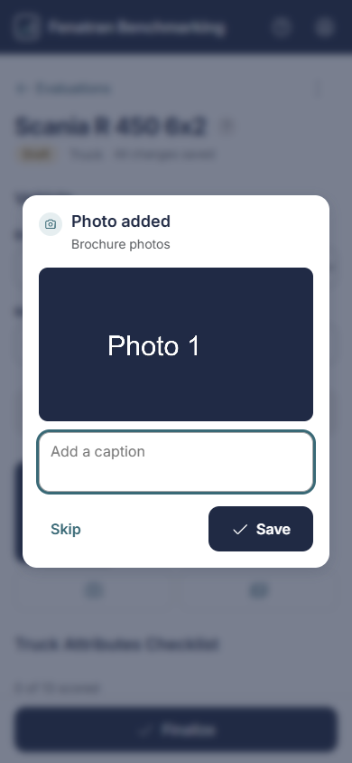
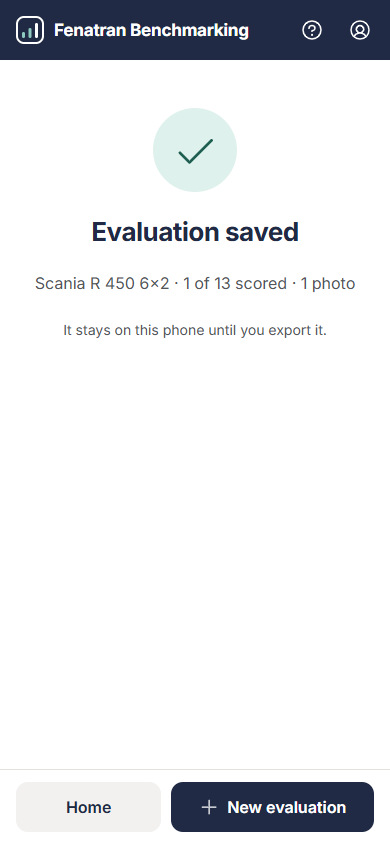

# FENATRAN 2026 Benchmarking - User guide

This guide is for the people who evaluate trucks, components, services and other offers at the FENATRAN 2026 fair. It covers how to install and open the app, record evaluations, export them to the team's WhatsApp group, and keep your phone storage under control. The same tips are in the app: tap the **?** icon at the top right.

The app works offline. You need an internet connection only to open it for the first time, and again when the team publishes an update.

## 1. Install and open the app

App link: <https://brenog-rossi.github.io/benchmark-FENATRAN/>

1. Open the app link on your phone or laptop, using the browser of your device (Safari on iPhone, Chrome on Android, Edge or Chrome on a laptop).
2. Wait until the first screen appears. The app downloads everything it needs during this first visit.
3. Optional: add the app to your home screen from the browser menu (on iPhone: Share, then "Add to Home Screen"; on Android: the menu, then "Install app" or "Add to Home screen"). It then opens like an app.

Do this once with internet access, before the fair. After that the app opens without a connection.

Your data is stored only on your device. Nothing is uploaded until you export it and share the ZIP files yourself.

### If the link is blocked on your computer

Some company networks block the app address. On the phone, use mobile data (4G/5G) for the first visit; after that the app works offline. On a computer, ask the team that maintains the app to run it locally for you; it then opens at <http://localhost:4173>. Data saved on the computer is separate from the data on your phone, so record fair evaluations on the phone.

## 2. Your profile

The first time you open the app, it asks only for your **e-mail**. Use your work e-mail: it identifies your evaluations in the export.

Tap **Start**. The app follows your phone's light or dark mode. When you start, the app asks the browser to keep your data safe on the device (persistent storage). Accept the browser prompt if it appears.

The two icons at the top right of every screen are:

- **?** (Help): on a phone, **How it works**: six step cards, each with a small picture of the screen. Swipe left for the next step. On a computer, short tips for every task at the fair.

- **Profile** (person icon): change your e-mail, then tap **Save profile**.

The Profile screen also has **Delete profile and data**. It removes your profile, all evaluations and all media from this phone, after you confirm with **Delete everything**, and the app returns to the first page. Export first if you need the data. This cannot be undone.

## 3. Home screen

The home screen lists your evaluations, grouped by day (newest day first, for example "Today · Thu 29 Oct"). Each row shows the truck or the other item, how many attributes are scored (trucks) or how many media items it has (other evaluations), and a status chip:

- **Draft**: you have not finalized it yet.
- **Ready**: finalized and ready to export. You can still edit it.

Below the list you also see:

- a hint with the number of evaluations ready to export;
- on a computer, the days you already sent and cleared ("... · sent"), for the last 7 export days;
- how much photo, video and audio data is stored on this phone.

The bar at the bottom has **Export** (shown when you have evaluations) and **New evaluation**.

On a phone, the home screen has two tabs at the top: **Evaluations** (the list) and **History**. History shows one card for each of the last 7 exports you cleared from the phone: the date and time, and each evaluation sent (title, Truck with the number of scored attributes, or Other with its category). Exports made before version 3.1 show only "Cleared from this phone". The **New evaluation** button stays at the bottom on both tabs.

On a phone, the list ends with a dashed **+ New evaluation** card, which does the same as the button in the bar.

If you have no evaluations yet, a phone shows a large **New evaluation** card in the middle of the screen; tap it or the button at the bottom. On a computer, the list says "No evaluations yet. Start with New evaluation."

### Delete an evaluation from the list

Swipe a row to the left. A **Delete** button appears behind it: tap it, or swipe further to delete at once. The message "Evaluation deleted" shows an **Undo** button for 5 seconds; tap it to bring the evaluation and its media back.

## 4. Create an evaluation

1. Tap **New evaluation**.
2. Choose **Truck** or **Other** (a component, service, aftermarket offer, partner or anything else).

### Truck evaluation

The truck editor has two parts.

**Vehicle**

- **Brand**: choose from the list. Choose "Other" and fill in **Brand name**.
- **Model**: for example "R 450 6x2".
- **First impressions** (optional): tap the row to open a text box for what strikes you first about the truck. The grey example text disappears when you type. The box grows as you write, then scrolls.
- **Brochure photos**: the camera and gallery buttons below the model add photos of the brochure. Only photos are allowed here.

**Truck Attributes Checklist**

There are 13 attributes in three sections: "Chassis & build", "Cab access & interior" and "Living space". The bar at the top of the checklist shows the total ("1 of 13 scored").

On a phone, nothing is open at first. The checklist is four tiles: one per section, each with how many of its attributes are scored ("1 of 4 scored"), and **Add attribute**. Tap a tile to open its attributes as cards over the screen. Swipe left or right to move between them; the dots under the cards show where you are. Tap **×** (top right), tap outside the cards or press Escape to go back.

Each card shows the number, the short title (for example "Seats") and the full description, then:

- **Score**: 0 to 5, in one bar. Tap a number to select it: the numbers up to it take a colour (red for 0-1, amber for 2-3, green for 4-5) and the chosen one is solid. Tap the selected number again to remove the score.
- **Media buttons**: the photos, videos and voice notes for this attribute (section 5).
- **Comment**: your observation in writing ("Add a comment"). The box grows as you type.

On a computer, the sections are a list. Tap a section title to open or close it, then tap an attribute to open it. The score there has a **Clear** button.

You do not have to score every listed attribute. An unscored attribute shows "-" in the summary and is blank in the Excel file.

**Final evaluation**

Below the checklist, tap **Final evaluation** (optional) to write your overall view of the truck. Like First impressions, it opens by itself when it already has text; tap the row again to close it.

**Your attributes**

If you find something the list does not cover, tap **+ Add attribute**, type a name (up to 60 characters, different from the other attributes) and tap **Add**. The new card opens with the same score, comment and media fields; on a phone, it opens in a "Your attributes" tile. Attributes you add **need a score**: they show "Required" until you score them, and **Finalize** takes you to the first one without a score. To delete one, open it and tap **Remove attribute**; its score, comment and media are deleted.

### Other evaluation

- **Category**: tap one of **Component**, **Service**, **Aftermarket**, **Partners** or **Other**. A new evaluation starts as Component.
- **Name**: for example "Battery", "Fleet portal" or "Service plan".
- **Manufacturer**: the supplier, brand or company.
- **Images, videos and voice notes**: the media for this evaluation.
- **Comments and observations**: free text.

To finalize, only these are required: brand and model (truck), the scores of the attributes you added (truck), or the name (Other).

### Autosave

Your changes are saved automatically on the device. The status line shows:

- "Saving..." while the app writes the change.
- "All changes saved" when it is done.
- "Could not save. Check free storage." if the phone is out of storage. Free some space (section 9) and try again.

You do not need to press a save button.

### Delete from the editor

Open the menu at the top right of the editor (three dots, "More actions") and choose **Delete evaluation**. The app asks "Delete this evaluation?" before it removes the evaluation and its media.

## 5. Media

Each media area is a row of icon buttons, with no title: **Camera** (take a photo now), **Gallery** (choose photos or videos already on the phone), **Video** (record a video) and **Voice note** (record a voice note; on devices without recording support, the app lets you pick an audio file instead).

Brochure photos accept photos only.

Right after you take a photo or choose one from the gallery, a card opens in the middle of the screen with the photo and a caption box. Type what the photo shows and tap **Save**, or tap **Skip** to add it later. Videos and voice notes do not open this card.

Tap an item to open it. In the item sheet you can:

- **Observation**: a short description of what the item shows (up to 500 characters). This text is used as the caption in the export and in the photo gallery. Only photos and videos with an observation appear in the gallery.
- **Mark up**: draw on a photo with a pen (4 colours, Undo), then tap **Save copy**. The copy has your marks; the original photo is kept.
- **Remove**: delete the item.
- **Done**: close the sheet.

Photos larger than 4096 px are resized when they are stored. Videos and voice notes are stored as recorded. The export keeps photos in this quality.

## 6. Finalize

When an evaluation is complete:

1. Open it and tap **Finalize** at the bottom.
2. The "Review and finalize" screen shows a summary card (title, number of attributes scored, photos) and the scored attributes. Tap "+ ... not scored" to see the rest. If something required is missing, the screen lists it under "Required before finalizing".
3. Tap **Confirm and finalize**. To keep working, tap **Back to editing**.

The "Evaluation saved" screen confirms it. The evaluation stays on this phone until you export it. After 2 seconds the app goes back to the Home list by itself (a short bar shows the count). Tap anywhere to stay on the screen; tap **New evaluation** to continue, or **Home** to go back to the list.

Finalized evaluations can still be changed. In that case the button in the editor reads **Review summary**.

## 7. Export to WhatsApp

Export once a day, and always before you clear the phone.

1. From the home screen tap **Export**.
2. "Today's export" shows how many trucks, other evaluations and photos go into the ZIP, the videos, voice notes and media size, and the list of evaluations. Drafts are included as they are; a note names them.
3. Tap **Create and share ZIP**. Photos are exported in original quality.

The file name looks like `FENATRAN2026_<e-mail name>_<yyyy-mm-dd>.zip`, where the e-mail name is the part of your e-mail before the @.

### If the export is too big

WhatsApp accepts files up to 100 MB. If the export is bigger, the app shows "The export is too big for WhatsApp" with three choices:

- **Split into parts**: creates several ZIP files (`..._part1of2.zip`, `..._part2of2.zip`). Each part has the full `data.json`, so any part can be read on its own.
- **Export without videos**: only available if there are videos. Photos and voice notes are kept.
- **Go back**: delete media first.

### Share the files

The screen "Your ZIP is ready" lists each ZIP file:

1. Tap **Share** to send the ZIP to the WhatsApp group. If sharing is not available, tap **Download** and attach the file in WhatsApp as a **document** (not as photo or gallery), so nothing is compressed.
2. Each ZIP you share or download gets a check mark. When every ZIP has one, the title changes to "Day sent".

The ZIP holds everything: the data, the summary, the Excel file, and all photos, videos and voice notes with their observations.

## 8. Clear the phone after sending

After you have sent everything to the group, clear the evaluations from the phone:

1. On the share screen, tap **Clear evaluations**. (Tap **Not yet** to go back to the home screen and keep the data.)
2. The dialog "Delete evaluations from this device?" asks you to confirm. Tap **Delete evaluations**.

This deletes all evaluations and all media. Your profile is kept, so you do not have to fill it in again. The home screen keeps a record of the export: on a phone in the **History** tab, on a computer as a short line for the day you sent.

Do not clear the phone until all ZIP files have reached the group. The deletion cannot be undone.

## 9. Storage tips

- Check the storage line at the bottom of the home screen often.
- Export daily. Each export frees room for new evaluations once you clear the phone after sending.
- Photos are exported in original quality, so ZIP files grow quickly. Export every day to keep each ZIP small.
- Use **Remove** on duplicate or blurry photos before you export.
- Keep free storage on the device. Close other apps before a long export.
- If you see "Could not save. Check free storage.", stop recording, free space, and try again.

## 10. Troubleshooting

| Problem | What to do |
| --- | --- |
| The app shows "Could not read data on this device". | Tap **Try again**. If it keeps happening, restart the browser. Your data is not removed. |
| You deleted an evaluation by mistake. | Tap **Undo** in the message at the bottom within 5 seconds. After that it cannot be restored. |
| The app is out of date. | Connect to the internet and reopen the app. The new version is used on the next visit. |
| Camera or microphone does not work. | Allow the camera and microphone for the browser in the phone's settings. |
| The ZIP does not share. | Tap **Download** and send the file from your downloads. |
| The app link does not open on a computer. | The network may block it. Use the local run at <http://localhost:4173> (see section 1). |

For questions about the app, contact the development team.
